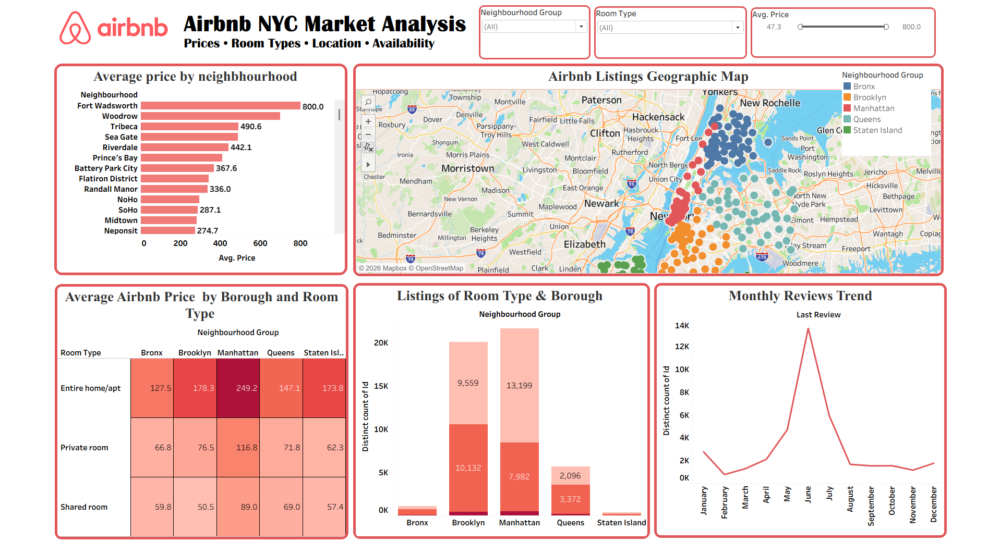
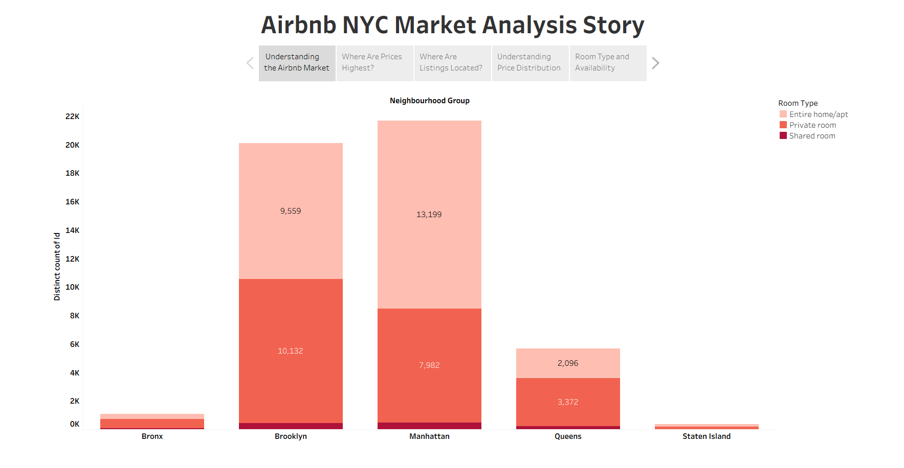
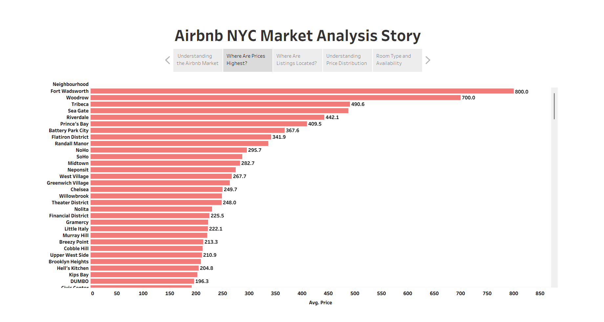
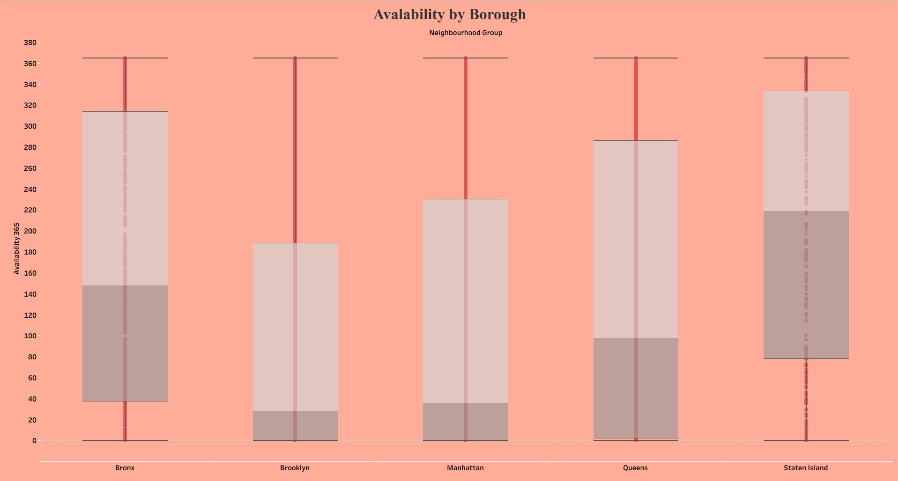
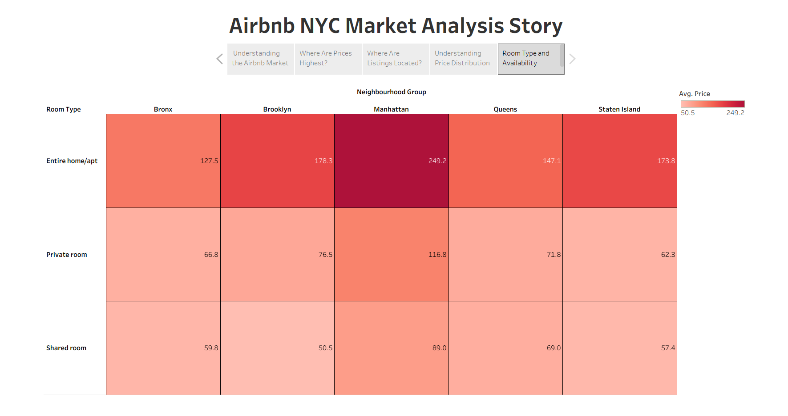
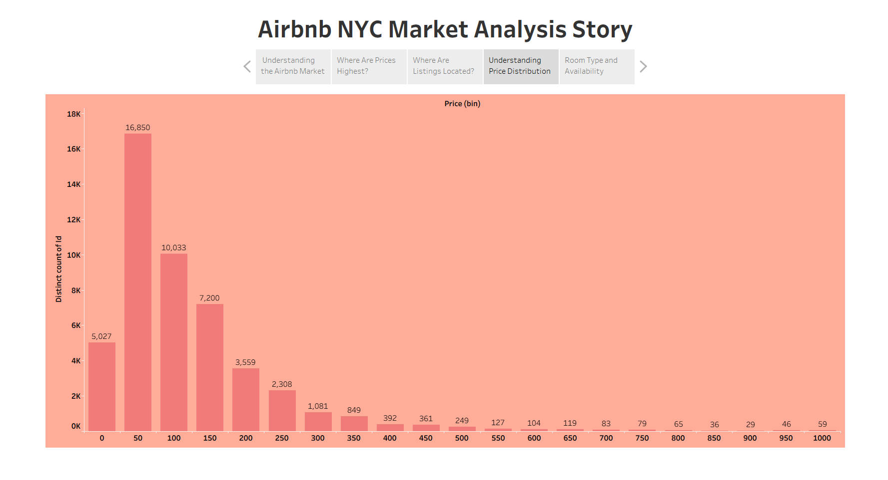
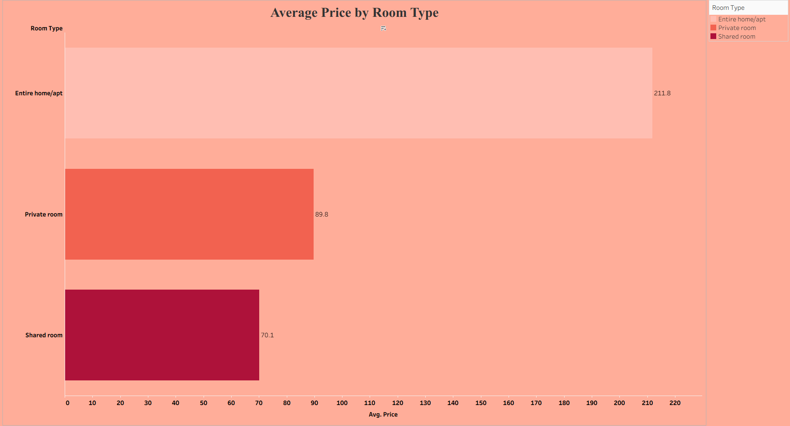

# 🏠 Airbnb NYC Market Analysis | Tableau

## 📌 Project Overview

The **Airbnb NYC Market Analysis** project explores the New York City short-term rental market using Tableau. It focuses on listing prices, room types, neighbourhoods, geographic distribution, and availability to help understand patterns across different areas.

The project uses interactive visualizations, dashboard filters, and Tableau Story points to present the analysis in a structured and user-friendly format.

## 🎯 Objectives

- Analyze average Airbnb listing prices by neighbourhood.
- Compare average prices across room types.
- Explore listing distribution across New York City's five boroughs.
- Visualize the geographic locations of Airbnb listings.
- Understand the distribution of listing prices.
- Compare room types and average prices across boroughs.
- Explore listing availability across boroughs.
- Present findings through an interactive Tableau dashboard and Story.

## 💼 Business Insights & Recommendations

The Tableau analysis explores Airbnb's NYC rental market from a business perspective.

### Key Business Questions

- **Neighbourhood Pricing:** Which neighbourhoods have higher average listing prices, and how can hosts use local price comparisons?
- **Room-Type Analysis:** How do prices vary across entire homes/apartments, private rooms, and shared rooms?
- **Market Competition:** Where are listings concentrated, and what does this reveal about the distribution of competing properties?
- **Price Distribution:** Which price ranges contain the largest number of listings?
- **Availability Patterns:** How does listing availability vary across boroughs?

### Potential Business Applications

1. **Pricing Strategy:** Compare a property with similar listings in the same neighbourhood and room category before setting prices.
2. **Competitive Analysis:** Examine listing concentration to understand the competitive landscape across boroughs.
3. **Property Positioning:** Use room-type and price comparisons to evaluate how a property could be positioned in the market.
4. **Market Exploration:** Help prospective hosts and researchers compare locations using geographic and pricing visualizations.
5. **Availability Review:** Investigate availability patterns alongside other data before making operational decisions.

### Analytical Note

These insights are based on descriptive analysis of listing-level data. Listing price and availability do not, by themselves, establish actual revenue, occupancy, profitability, or customer demand. Business recommendations should be validated with the observed chart results and additional data where necessary.

## 🛠️ Tools Used

- **Tableau** — data visualization, interactive dashboards, filters, maps, and storytelling.
- **Airbnb NYC dataset** — listing-level information used for market analysis.

## 📊 Worksheets and Visualizations

1. **Average Price by Neighbourhood** — compares average listing prices across neighbourhoods.
2. **Average Price by Room Type** — compares pricing across room categories.
3. **Listings by Room Type and Borough** — explores listing distribution by borough and room type.
4. **Airbnb Listings Geographic Map** — visualizes listing locations across New York City.
5. **Airbnb Price Distribution** — examines the distribution of listing prices using a histogram.
6. **Borough Room Type Heatmap** — compares average prices across room types and boroughs.
7. **Availability by Borough** — explores listing availability across boroughs.
8. **Monthly Reviews Trend** — explores review activity over time, where supported by the available review-date data.

## 📈 Dashboard Features

- Interactive filters for neighbourhood group, room type, and price.
- Geographic visualization of Airbnb listings.
- Comparative pricing charts.
- Room-type and borough analysis.
- Availability analysis.
- A Tableau Story to guide users through the analysis.

## 🖼️ Dashboard Preview

### 1. Dashboard Overview

### 2.Tableau Story

### 3. Price Analysis

## 💡 Key Learning Outcomes

- Creating interactive dashboards in Tableau.
- Designing and formatting charts for business reporting.
- Using filters to explore data by category and price.
- Building geographic visualizations.
- Comparing market patterns across neighbourhoods and room types.
- Presenting analytical work through data storytelling.

## 🚀 How to View the Project

1. Clone or download this repository.
2. Open the `.twbx` workbook using Tableau Desktop.
3. Navigate through the worksheets, dashboard, and Story points.
4. Use the available filters to explore the visualizations.

## 👩‍💻 Author

**Gouri Subrahmanian**

Aspiring Data Analyst | MCA Graduate

Skills: Tableau, SQL, Excel, Power BI, Python, Data Visualization, and Business Analytics.

